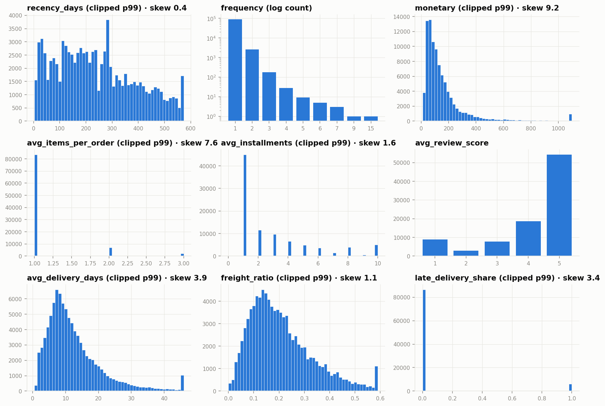
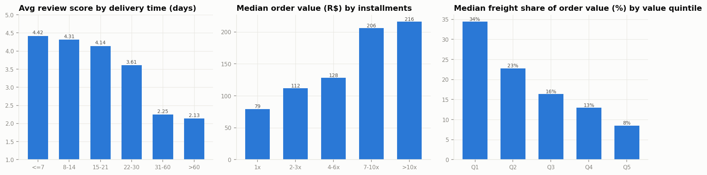
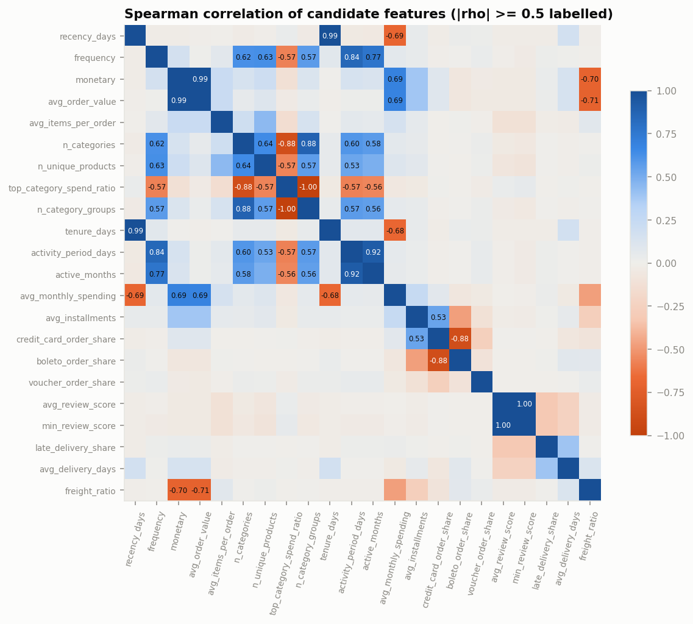

# EDA Report

Notebooks: `04_data_profiling_eda/notebooks/01..05_*.ipynb` (executed, outputs saved). Source profile:
[data_profiling_report.md](data_profiling_report.md). Data quality: 23 PASS,
0 WARN, 3 INFO, 0 FAIL
(`05_data_engineering/validation/data_quality_report.md`).

## Univariate

- **97.0% of customers bought exactly once.** Frequency is almost constant → RFM frequency
  cannot be quantile-scored and repeat behaviour is the rare, valuable signal.
- Monetary is heavily right-skewed (log transform needed for distance-based clustering).
- Reviews are polarised: most 5-star, a second mode at 1 star.

## Bivariate

- **Delivery time drives satisfaction:** average review 4.29 for on-time vs
  **2.27 for late** orders; Spearman ρ(delivery days, review) = -0.23.
- Higher-value orders are paid in more installments (ρ = 0.38).
- Freight is a far larger share of small orders (Q1 vs Q5 of order value) → price sensitivity to shipping.
- Repeat customers' lifetime spend (median R$ 225.63) is ~2× one-time buyers'
  (R$ 105.38), but their **average order value is about the same**
  (R$ 110.04 vs R$ 105.38): repeat customers are valuable because they come back,
  not because they buy bigger baskets.

## Multivariate

Highly correlated pairs (|ρ| > 0.8, handled by feature screening):
- `recency_days` ~ `tenure_days` (ρ = 0.99)
- `frequency` ~ `activity_period_days` (ρ = 0.84)
- `monetary` ~ `avg_order_value` (ρ = 0.99)
- `n_categories` ~ `top_category_spend_ratio` (ρ = -0.88)
- `n_categories` ~ `n_category_groups` (ρ = 0.88)
- `top_category_spend_ratio` ~ `n_category_groups` (ρ = -1.00)
- `activity_period_days` ~ `active_months` (ρ = 0.92)
- `credit_card_order_share` ~ `boleto_order_share` (ρ = -0.88)
- `avg_review_score` ~ `min_review_score` (ρ = 1.00)

PCA on the 8 profile features: the first three components explain
24.3%, 17.6%, 13.4% of variance — no dominant low-dimensional structure, i.e.
customers form a continuum rather than well-separated natural clusters (expect modest silhouette values).
