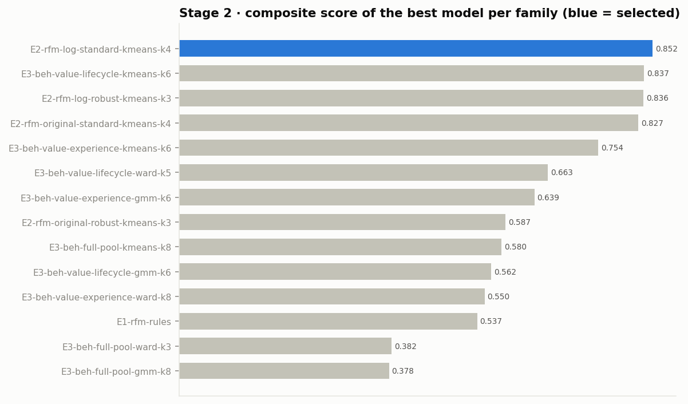
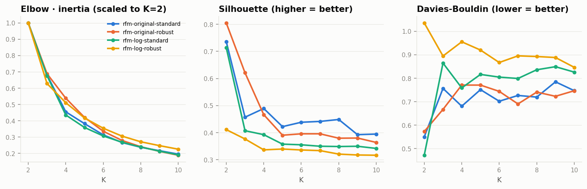
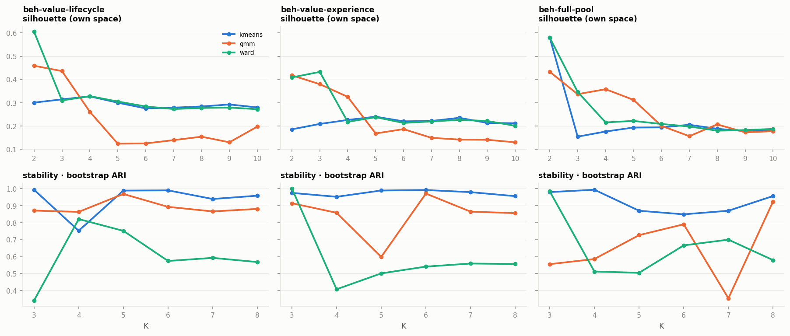
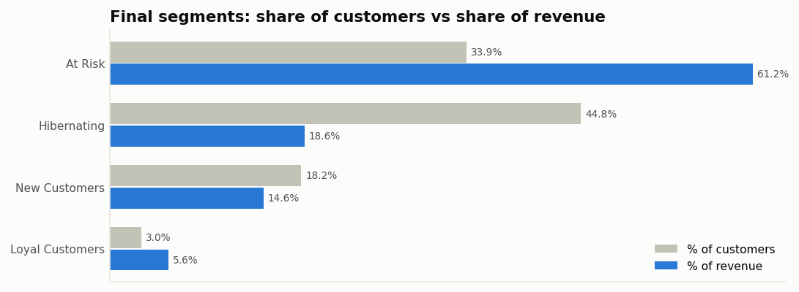
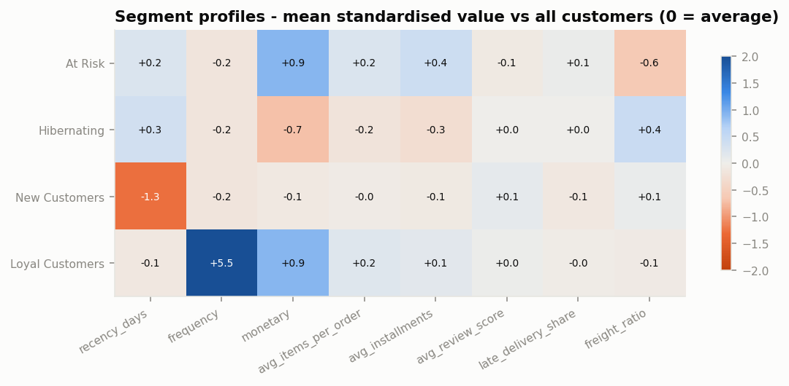
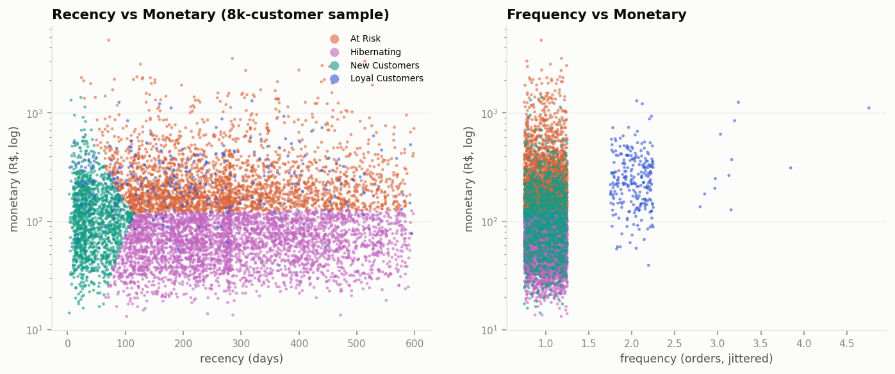

# Experiment Results & Final Segmentation Model

## 1. Selected model

**E2-rfm-log-standard-kmeans-k4** — kmeans with K = 4 on feature configuration `rfm-log-standard`
(composite 0.852; runner-up E3-beh-value-lifecycle-kmeans-k6 0.837, margin 0.015).
Bootstrap stability ARI 0.992, multi-seed ARI 0.990,
smallest cluster 3.0% of customers. Model artifact: `artifacts/models/final_segmentation_model.joblib`.

## 2. Stage-2 comparison (metrics averaged over the 7 candidate feature spaces)

| rank | run_id | k | own_silhouette | silhouette | davies_bouldin | stability_bootstrap_ari | size_entropy | min_cluster_share | interpretability | composite |
|---|---|---|---|---|---|---|---|---|---|---|
| 1 | E2-rfm-log-standard-kmeans-k4 | 4 | 0.393 | 0.209 | 1.629 | 0.992 | 0.824 | 3.0% | 0.875 | 0.852 |
| 2 | E3-beh-value-lifecycle-kmeans-k6 | 6 | 0.276 | 0.134 | 4.065 | 0.989 | 0.923 | 3.0% | 0.917 | 0.837 |
| 3 | E2-rfm-log-robust-kmeans-k3 | 3 | 0.377 | 0.201 | 1.708 | 0.994 | 0.947 | 19.0% | 0.833 | 0.836 |
| 4 | E2-rfm-original-standard-kmeans-k4 | 4 | 0.489 | 0.244 | 1.380 | 0.997 | 0.647 | 2.6% | 0.875 | 0.827 |
| 5 | E3-beh-value-experience-kmeans-k6 | 6 | 0.220 | 0.075 | 6.931 | 0.991 | 0.862 | 3.0% | 0.917 | 0.754 |
| 6 | E3-beh-value-lifecycle-ward-k5 | 5 | 0.305 | 0.151 | 5.150 | 0.751 | 0.857 | 3.0% | 0.900 | 0.663 |
| 7 | E3-beh-value-experience-gmm-k6 | 6 | 0.187 | 0.041 | 6.895 | 0.970 | 0.831 | 3.0% | 0.833 | 0.639 |
| 8 | E2-rfm-original-robust-kmeans-k3 | 3 | 0.621 | 0.360 | 2.069 | 0.995 | 0.345 | 1.0% | 0.667 | 0.587 |
| 9 | E3-beh-full-pool-kmeans-k8 | 8 | 0.188 | 0.048 | 6.321 | 0.956 | 0.877 | 2.3% | 0.750 | 0.580 |
| 10 | E3-beh-value-lifecycle-gmm-k6 | 6 | 0.125 | -0.052 | 7.111 | 0.892 | 0.832 | 3.0% | 0.833 | 0.562 |
| 11 | E3-beh-value-experience-ward-k8 | 8 | 0.226 | 0.080 | 6.277 | 0.557 | 0.917 | 3.0% | 0.938 | 0.550 |
| 12 | E1-rfm-rules | 10 | nan | 0.093 | 2.863 | 0.993 | 0.873 | 0.2% | 0.600 | 0.537 |
| 13 | E3-beh-full-pool-ward-k3 | 3 | 0.347 | 0.105 | 8.576 | 0.984 | 0.363 | 3.6% | 0.667 | 0.382 |
| 14 | E3-beh-full-pool-gmm-k8 | 8 | 0.207 | -0.047 | 8.077 | 0.924 | 0.678 | 1.9% | 0.688 | 0.378 |

`own_silhouette` = silhouette in the model's own training space (not comparable across rows; shown for reference).

## 3. What each experiment showed

**E1 — RFM rule-based.** Deterministic and perfectly explainable, bootstrap ARI 0.993
(quintile edges barely move). But 10 rules on a base where 97 % bought once produce segments that differ almost only
in recency: Champions 1.1%, Loyal 0.6%,
Potential Loyalists 0.2% — the three loyalty segments together are
< 2 % of customers. Lowest interpretability score of the finalists (0.60): several
segments share the same signature. Quintile edges: recency [94, 179, 270, 383] days,
monetary [55.24, 87.33, 132.59, 208.47] R$.

**E2 — RFM + K-Means.** 
The log transform is essential: without it K-Means isolates a handful of extreme spenders (original-robust K = 3
has a 1.0% cluster).
RobustScaler leaves `frequency` unscaled (IQR = 0), so the robust variants split mainly on repeat-vs-one-time.
Best E2 model: E2-rfm-log-standard-kmeans-k4.

**E3 — Behavioural clustering.** 
K-Means is stable in every feature space (bootstrap ARI 0.96-1.00); GMM (0.89-0.97) and Ward
fitted on 20k-customer samples (0.56-0.98) vary more with the seed / sample.
The full screened pool (15 features) produces the lowest-ranked finalists
(ranks 9, 13, 14 of 14): near-constant count
features dominate the distances. DBSCAN (exploratory, 10k samples, eps = P90 of the k-distance curve) finds
5–13 dense groups with 4.9%–7.2%
noise; the largest group holds 45.8%–88.9% of the clustered
customers and the smallest are 0.1%–0.9% fragments — density-based
clustering does not suit this continuous customer space and was not shortlisted.

## 4. Final segments

| segment_id | segment_name | customers | customer_share | revenue_contribution | avg_recency_days | avg_frequency | avg_monetary | avg_order_value | repeat_rate | churn_rate | avg_review_score | late_delivery_share | avg_installments |
|---|---|---|---|---|---|---|---|---|---|---|---|---|---|
| S1 | At Risk | 31,608 | 33.9% | 61.2% | 275 | 1.00 | R$ 298 | R$ 298 | 0.0% | 43.7% | 4.04 | 8.4% | 4.0 |
| S2 | Hibernating | 41,746 | 44.8% | 18.6% | 291 | 1.00 | R$ 68 | R$ 68 | 0.0% | 48.2% | 4.17 | 6.9% | 2.2 |
| S3 | New Customers | 16,961 | 18.2% | 14.6% | 47 | 1.00 | R$ 133 | R$ 133 | 0.0% | 0.0% | 4.31 | 4.0% | 2.7 |
| S4 | Loyal Customers | 2,789 | 3.0% | 5.6% | 222 | 2.11 | R$ 309 | R$ 146 | 100.0% | 32.8% | 4.20 | 5.8% | 3.3 |

Naming is rule-based on each cluster's profile (`final_segmentation.name_clusters`): loyalty (repeat rate ≥ 50 %)
→ experience (late share ≥ 40 % or review ≤ 3) → distinctive behaviour (installments / basket size / freight
burden ≥ 0.8 SD) → lifecycle (recency ≥ 0.8 SD) → value. Full profiles: `10_business_insights/segment_profiles.md`.

## 5. Conclusion

**E2-rfm-log-standard-kmeans-k4** is selected on the best overall composite: high stability (bootstrap ARI 0.992; the most stable finalist is E2-rfm-original-standard-kmeans-k4 at 0.997), good size balance (0.82) and four segments that each have a distinct signature (interpretability 0.88). The margin over the best behavioural model **E3-beh-value-lifecycle-kmeans-k6** is small (0.852 vs 0.837, delta 0.015); a different but defensible weighting could flip it. Because 97.0% of customers buy once, the RFM space is essentially *recency x spend x repeat-or-not*, and K-Means recovers exactly those groups. The behavioural models add information the RFM model cannot see: `E3-beh-value-lifecycle-kmeans-k6` isolates a financing cluster (18,141 customers, 6.9 installments on average), a multi-item cluster (2.4 items/order, review 3.61); `E3-beh-value-experience-kmeans-k6` isolates a financing cluster (20,096 customers, 6.4 installments on average), a multi-item cluster (2.4 items/order, review 3.66), a late-delivery cluster (6,126 customers, 100.0% of orders late, review 2.26). The labels of E3-beh-value-lifecycle-kmeans-k6 are therefore kept on every customer (`mart.customer_segmentation.e3_cluster`) as a secondary lens, and the experience drivers are tracked as KPIs. E1 (10 rules) ranks 12 of 14: deterministic and explainable, but with three loyalty segments below 2 % of customers and overlapping signatures it over-segments this one-time-buyer base; its label (`rfm_segment`) stays available for CRM list pulls.
