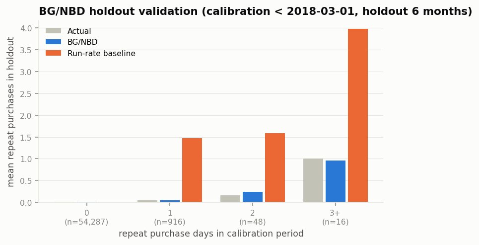
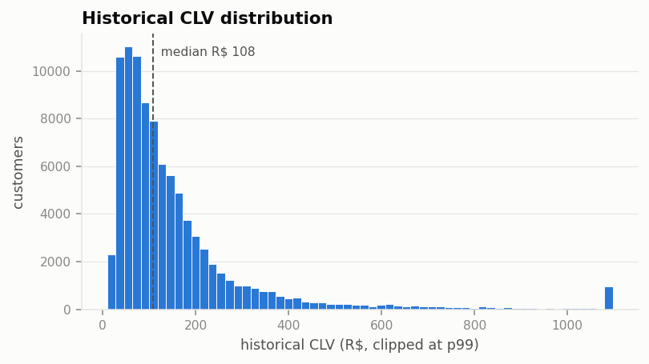
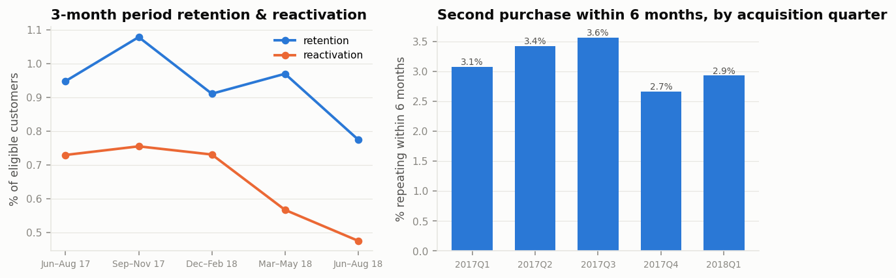
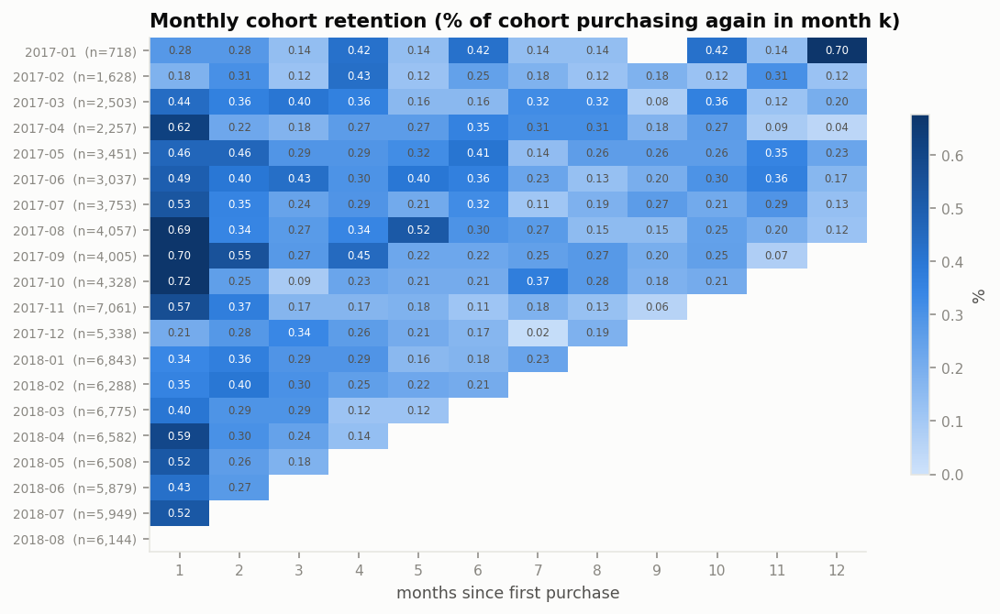
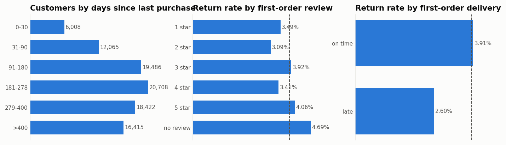
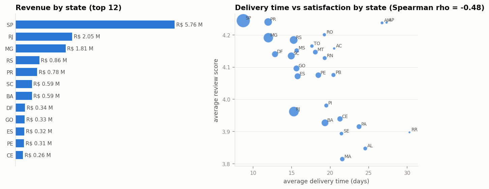
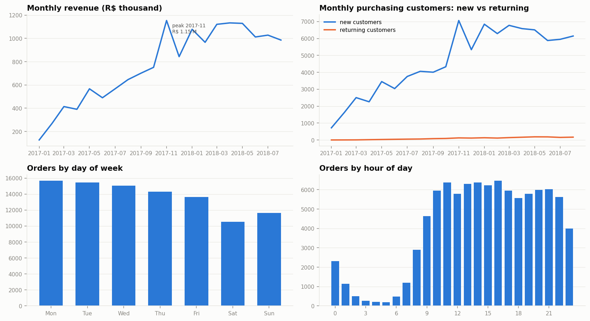
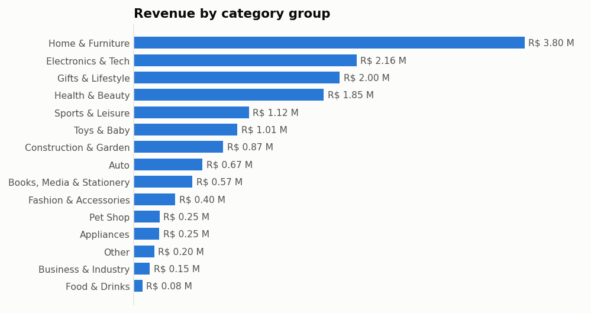

# Customer Analytics Report (PRD 6)

Generated by `custseg.analytics` / `custseg.clv`. Folder per analysis under `08_customer_analytics/`.

## 6.1 RFM analysis
See `07_customer_segmentation/results/EXPERIMENT_RESULTS.md` (E1) and `mart.customer_segmentation` (r/f/m scores,
`rfm_segment` on every customer).

## 6.2 Customer Lifetime Value
- **Historical CLV** = revenue to date: median R$ 107.78; top 1 % above R$ 1,098.
- **Predictive CLV** = BG/NBD × Gamma-Gamma (implemented from the papers with SciPy MLE; unit = purchase day).
  - BG/NBD parameters (full period): r = 0.0157, α = 9.52,
    a = 2.059, b = 0.351.
  - **Time-based validation** (calibration < 2018-03-01, holdout 26.3 weeks,
    55,267 customers): actual **696** repeat purchases vs BG/NBD
    **734** (+5.4%) vs naive run-rate
    1485 (+113.4%). MAE 0.0252 vs
    0.0374. The top 10 % of customers ranked by the model captured 21.7%
    of holdout repeat purchases (2.2× random). Calibrated in aggregate, weak at ranking individuals
    (Spearman 0.034) — only 1.18% of customers repeat in 6 months.
  - **Gamma-Gamma assumption check:** Pearson r(frequency, avg repeat value) = 0.002
    (p = 0.92, n = 2,005) → independence
    holds; model fitted on repeat customers only.
  - Expected repeat revenue from the **existing base in the next 12 months: R$ 230,277**
    (≈ R$ 2.47 per customer) vs
    R$ 15,373,120 historical. **Olist's value is almost entirely first-purchase value.**

## 6.3 Retention
- Repeat purchase rate **3.00%** (2,789 of 93,104).
- 3-month period retention (eligible = buyers of the previous period):

| period | eligible_customers | retained_customers | retention_rate | churn_rate | inactive_customers | reactivated_customers | reactivation_rate | new_customers |
|---|---|---|---|---|---|---|---|---|
| Jun–Aug 17 | 8,227 | 78 | 0.95% | 99.05% | 2,330 | 17 | 0.73% | 10,847 |
| Sep–Nov 17 | 10,942 | 118 | 1.08% | 98.92% | 10,462 | 79 | 0.76% | 15,394 |
| Dec–Feb 18 | 15,591 | 142 | 0.91% | 99.09% | 21,207 | 155 | 0.73% | 18,469 |
| Mar–May 18 | 18,766 | 182 | 0.97% | 99.03% | 36,501 | 207 | 0.57% | 19,865 |
| Jun–Aug 18 | 20,254 | 157 | 0.78% | 99.22% | 54,878 | 261 | 0.48% | 17,972 |

- Repeat rate by final segment: Loyal Customers 100.0%, At Risk 0.0%, Hibernating 0.0%, New Customers 0.0%

## 6.4 Cohort analysis
Average month-1 cohort retention 0.48%, month-3 0.25%.
Revenue after the acquisition month is 2.2% (median cohort)
of a cohort's total revenue. Second purchase within 6 months by acquisition quarter:
2017Q1 3.07%, 2017Q2 3.42%, 2017Q3 3.56%, 2017Q4 2.66%, 2018Q1 2.93% — no improving trend.

## 6.5 Churn
- **Inactivity threshold T = 278 days** = P90 of the gaps between consecutive purchase occasions of
  repeat customers (2,188 gaps ≥ 1 day; 29.6% of raw gaps were same-day
  split orders and are excluded). Median gap 71 days. Caveat: gaps are right-censored by the 20-month window, so long gaps are under-observed; T is therefore a lower bound of the true purchase cycle.
- Snapshot: **34,837 customers (37.4%) inactive > T** → "churned";
  58,267 still inside the window. This is a rule-based status, not a churn prediction.
- Historical churn: of 35,498 customers with a full T-day observation window,
  **96.2% never purchased again within T days**.
- Which first-order experiences go with *not* returning (χ² test, Cramér's V; Mann-Whitney for continuous):

| dimension | chi2 | dof | p_value | cramers_v | min_rate | max_rate |
|---|---|---|---|---|---|---|
| first_category_group | 123.6 | 13 | 0.0000 | 0.059 | 2.15% | 5.15% |
| installments_band | 28.5 | 3 | 0.0000 | 0.028 | 3.40% | 5.01% |
| state | 11.1 | 15 | 0.7473 | 0.018 | 2.03% | 4.17% |
| review_band | 9.4 | 5 | 0.0933 | 0.016 | 3.09% | 4.69% |
| delivery | 7.4 | 1 | 0.0064 | 0.014 | 2.60% | 3.91% |
| value_band | 3.7 | 3 | 0.2988 | 0.010 | 3.63% | 4.16% |
| payment_type | 1.8 | 3 | 0.6230 | 0.007 | 3.07% | 4.42% |

  Return rate after an on-time first delivery 3.91% vs late
  2.60%. All effects are statistically detectable but **small**
  (Cramér's V < 0.1): no single first-order factor explains the 96 % non-return — it is structural to the marketplace.

## 6.6 Product affinity (market basket)
- Orders containing ≥ 2 categories: **778 of 96,211
  (0.81%)**; customers with ≥ 2 categories over their history:
  2,260 (2.43%).
- Apriori (min support 10 baskets, lift > 1): 2 order-level and
  4 customer-level rules.

| level | antecedent | consequent | support_count | confidence | lift |
|---|---|---|---|---|---|
| customer | bed_bath_table | home_confort | 54 | 0.6% | 1.43 |
| order | bed_bath_table | home_confort | 43 | 0.5% | 1.14 |
| customer | construction_tools_lights | furniture_decor | 18 | 7.4% | 1.13 |

  **Data supports affinity analysis only weakly** (PRD acceptance: "if data supports"): co-purchase is rare, so
  bundling should be tested as an experiment rather than rolled out from these rules.

## 6.7 Geography
| region | customers | revenue | revenue_share | avg_spend | avg_delivery_days | avg_review | repeat_rate |
|---|---|---|---|---|---|---|---|
| Sudeste | 63,824 | R$ 9,934,861 | 64.6% | R$ 155.66 | 10.7 | 4.18 | 3.11% |
| Sul | 13,335 | R$ 2,229,134 | 14.5% | R$ 167.16 | 14.0 | 4.19 | 2.92% |
| Nordeste | 8,777 | R$ 1,816,204 | 11.8% | R$ 206.93 | 20.0 | 3.96 | 2.36% |
| Centro-Oeste | 5,431 | R$ 992,777 | 6.5% | R$ 182.80 | 15.0 | 4.13 | 2.96% |
| Norte | 1,737 | R$ 400,144 | 2.6% | R$ 230.37 | 22.6 | 4.04 | 2.76% |

Across states, slower delivery goes with lower reviews (Spearman ρ = -0.48,
p = 0.011). Remote states spend more per customer but wait longer.

## 6.8 Purchase patterns
- Peak month **2017-11** (R$ 1,153,364, 7,289 orders — Black Friday).
- Jan–Aug 2018 vs Jan–Aug 2017: revenue +143%, orders +140% — growth is acquisition-driven.
- Average purchase interval (repeaters, gaps ≥ 1 day) 111 days (median 71).
- 1.14 items per order, AOV R$ 159.79, credit card on 75.5% of orders,
  average 2.9 installments.

