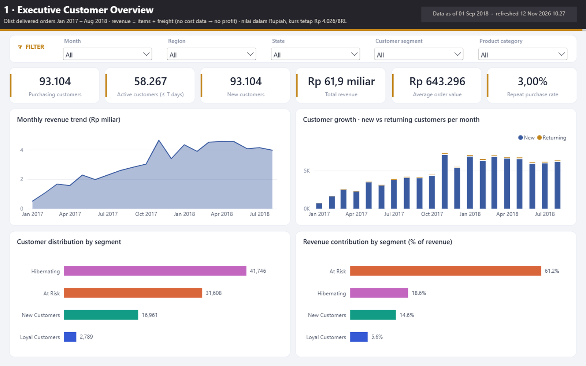
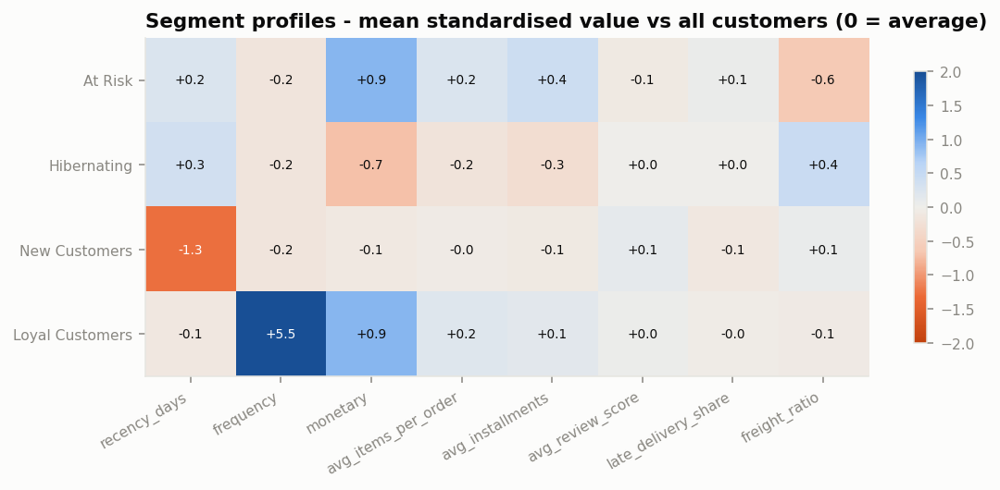
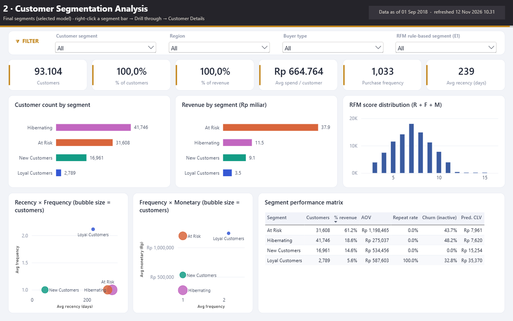
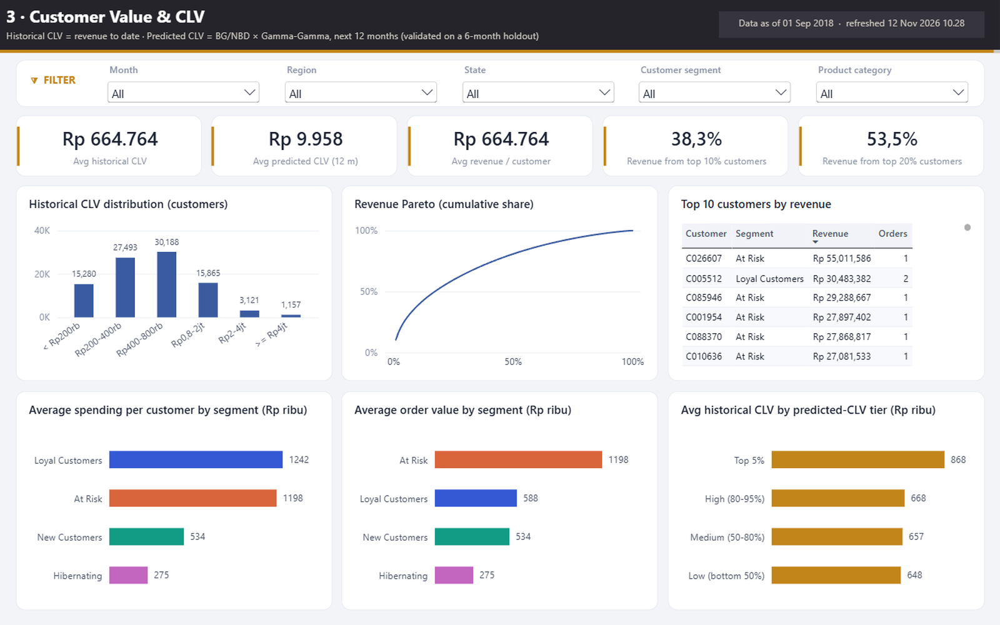
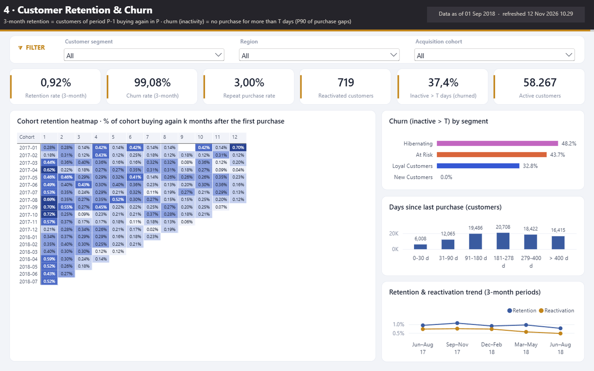
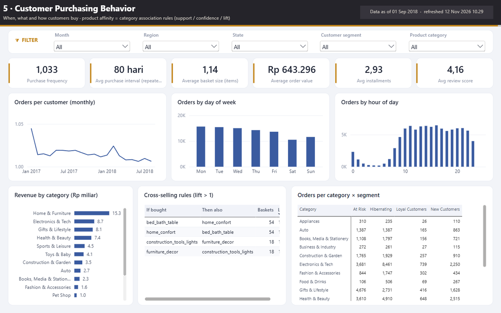
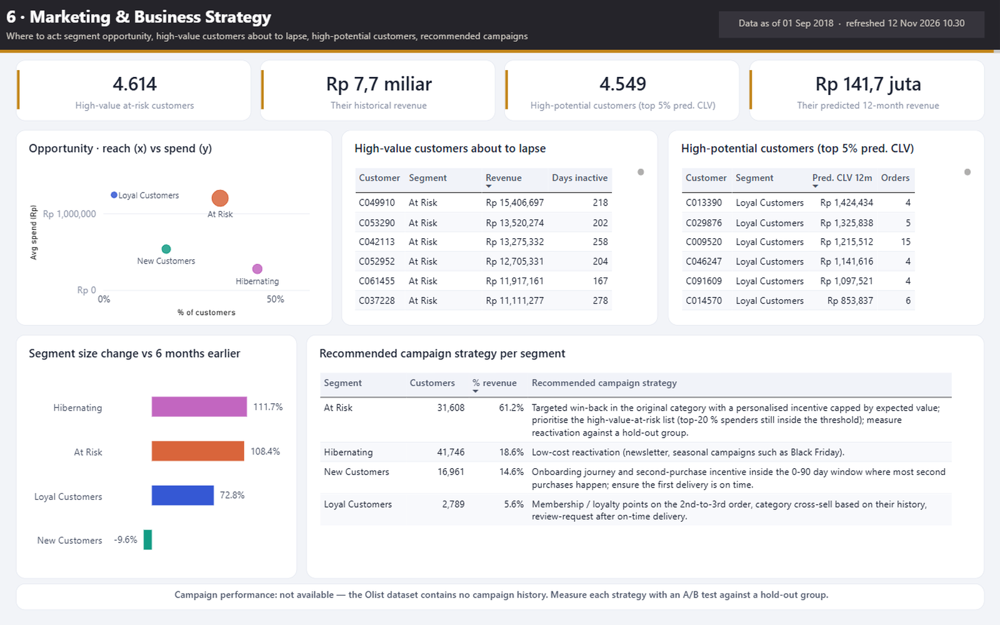
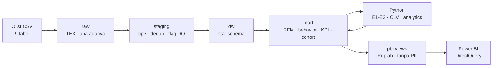

# 🧭 Customer Segmentation & Analytics Platform


**Segmentasi dan analitik pelanggan end-to-end** di data e-commerce nyata (Olist, Brasil, 93 ribu pelanggan).
Alurnya: data warehouse PostgreSQL, tiga pendekatan segmentasi yang dibandingkan secara adil, lalu CLV, retensi,
churn, kohort dan market basket, sampai **dashboard Power BI 6 halaman** yang di-generate dari kode. Semua
mengikuti dokumen kebutuhan produk (PRD) internal dan bisa direproduksi dengan satu perintah.



---

## Ringkasan

| | |
|---|---|
| **Masalah** | Marketplace punya data transaksi besar tetapi belum punya pandangan per pelanggan: siapa yang bernilai, siapa yang hampir hilang, dan kampanye apa yang cocok untuk tiap kelompok |
| **Pendekatan** | Warehouse 4 lapis (raw → staging → star schema → data mart), 26 cek kualitas data, 3 eksperimen segmentasi (127 run tercatat) dengan seleksi dua tahap yang bebas bias ruang fitur, CLV probabilistik (BG/NBD × Gamma-Gamma) yang divalidasi pada holdout waktu |
| **Hasil** | 4 segmen yang bisa ditindaklanjuti · **61,2% revenue ada di segmen *At Risk*** · keterlambatan pengiriman terbukti menurunkan rating (4,29★ → 2,27★) dan peluang kembali · 78 measure DAX tervalidasi identik dengan SQL |

### Angka utama (Jan 2017 – Agu 2018, snapshot 1 Sep 2018)

| Aspek | Hasil |
|---|---|
| Skala | **93.104** pelanggan · 96.211 order terkirim · revenue **Rp 61,9 miliar** |
| Perilaku | **97%** pelanggan hanya belanja sekali · repeat purchase rate **3,00%** · retensi 3-bulanan **0,92%** |
| Konsentrasi | 10% pelanggan teratas = **38,3%** revenue · 20% teratas = **53,5%** |
| Churn | ambang inaktif **T = 278 hari** (P90 jarak antar-pembelian) · 37,4% pelanggan sudah melewati T |
| CLV | BG/NBD memprediksi **734** pembelian ulang di holdout 6 bulan vs aktual **696** (baseline naif: 1.485) |
| Model terpilih | `RFM (log) + StandardScaler + K-Means, K=4`: stabilitas bootstrap ARI 0,992, unggul tipis atas model behavioural K=6 |

> Analisis berjalan dalam BRL (mata uang sumber). Dashboard dan README menampilkan **Rupiah** dengan kurs tetap
> **Rp 4.026/BRL** (rata-rata tahunan 2017 & 2018 dibobot revenue), jadi semua rasio tidak berubah.

---

## Segmen akhir

| | Segmen | Pelanggan | % pelanggan | % revenue | Rata-rata belanja | Inaktif > T | Strategi |
|---|---|---:|---:|---:|---:|---:|---|
| 🟧 | **At Risk** | 31.608 | 33,9% | **61,2%** | Rp 1.198.465 | 43,7% | win-back di kategori asal, mulai dari daftar *high-value at-risk* |
| 🟪 | **Hibernating** | 41.746 | 44,8% | 18,6% | Rp 275.037 | 48,2% | reaktivasi berbiaya rendah, ambang free-shipping |
| 🟩 | **New Customers** | 16.961 | 18,2% | 14,6% | Rp 534.456 | 0% | onboarding + insentif pembelian kedua dalam 90 hari |
| 🟦 | **Loyal Customers** | 2.789 | 3,0% | 5,6% | Rp 1.242.204 | 32,8% | program loyalitas, cross-sell, prioritas pengiriman |



Profil lengkap tiap segmen (recency, frequency, monetary, AOV, CLV, retensi, churn, pertumbuhan, strategi) ada di
[`10_business_insights/segment_profiles.md`](10_business_insights/segment_profiles.md).

---

## Temuan paling menarik

1. **Hampir semua pelanggan hanya belanja sekali.** 97% pelanggan punya satu order, dan 96,2% pelanggan dengan jendela
   observasi penuh tidak pernah kembali. Nilai repeat 12 bulan dari seluruh basis hanya ±Rp 0,93 miliar (1,5% dari
   histori). Pertumbuhan Olist bergantung pada akuisisi, sehingga *pembelian kedua* paling layak dijadikan north-star metric CRM.
2. **Revenue terkonsentrasi di pelanggan yang sedang "menghilang".** Segmen *At Risk* (pembeli tiket besar,
   rata-rata 4 cicilan) menyumbang 61,2% revenue, dan 43,7% di antaranya sudah melewati ambang inaktif.
3. **Keterlambatan pengiriman adalah driver yang bisa dikendalikan.** Order terlambat rata-rata 2,27★ vs 4,29★ tepat
   waktu, dan pelanggan yang order pertamanya terlambat lebih jarang kembali (2,60% vs 3,91%, p = 0,006).
4. **Segmen = tahap lifecycle.** Dari pelanggan berstatus *New* enam bulan sebelumnya, 60,5% kini *Hibernating* dan
   38,2% *At Risk*. Jendela untuk bertindak sempit (median jarak pembelian 71 hari).
5. **Sinyal cross-sell lemah.** Hanya 0,8% order berisi lebih dari satu kategori, jadi bundling perlu diuji lewat A/B
   test, bukan langsung digulirkan.

Detail dan rekomendasi: [`customer_insights.md`](10_business_insights/customer_insights.md) ·
[`marketing_recommendations.md`](10_business_insights/marketing_recommendations.md) ·
[`executive_summary.md`](10_business_insights/executive_summary.md)

---

## Dashboard Power BI

Dashboard disimpan sebagai **Power BI Project (PBIP)**: semantic model dalam TMDL dan report dalam PBIR, semuanya
di-generate oleh [`11_powerbi/build_pbip.py`](11_powerbi/build_pbip.py). Isinya star schema dengan DirectQuery ke
PostgreSQL, 78 measure DAX, drill-through ke detail pelanggan, tooltip per segmen, dan tema *Charcoal & Coral* dengan
warna segmen yang sudah divalidasi aman untuk buta warna.

| Segmentation Analysis | Customer Value & CLV |
|---|---|
|  |  |
| **Retention & Churn** | **Purchasing Behavior** |
|  |  |



Panduan halaman per halaman: [`12_documentation/dashboard_documentation.md`](12_documentation/dashboard_documentation.md)

---

## Metodologi



**Tiga eksperimen segmentasi** ([experiment plan](06_experimental_design/experiment_plan.md)):

| | Pendekatan | Variasi yang diuji |
|---|---|---|
| E1 | RFM rule-based | skor kuintil R & M, tier F absolut (F tidak bisa dikuintilkan karena 97% = 1), 10 aturan segmen |
| E2 | RFM + K-Means | {original, log} × {Standard, Robust} scaler × K 2–10 |
| E3 | Behavioural clustering | 3 konfigurasi fitur hasil screening × {K-Means, GMM, Ward} × K 2–10, plus DBSCAN eksploratif |

**Seleksi model yang adil.** Silhouette, Davies-Bouldin dan Calinski-Harabasz hanya bisa dibandingkan dalam satu ruang
fitur. Versi awal tahap ini menilai semua finalis di ruang RFM, dan model RFM menang. Saat dinilai di ruang profil
8-fitur, model behavioural yang memakai fitur persis itu yang menang. Keduanya bias "kandang". Solusinya: setiap
finalis dinilai di **ketujuh** ruang kandidat lalu dirata-rata, digabung dengan stabilitas (bootstrap ARI),
keseimbangan ukuran klaster dan skor interpretabilitas bisnis
([evaluation framework](06_experimental_design/evaluation_framework.md)). Margin pemenangnya kecil (0,015) dan
dilaporkan apa adanya. Label model behavioural tetap disimpan sebagai lensa kedua.

**Analitik pendukung** ([laporan lengkap](08_customer_analytics/ANALYTICS_REPORT.md)):
- CLV historis dan prediktif (BG/NBD × Gamma-Gamma, diimplementasikan langsung dari paper dengan SciPy, asumsi independensi diuji)
- retensi periode, kohort, dan churn dengan ambang berbasis data
- uji driver churn (χ², Cramér's V, Mann-Whitney)
- market basket (Apriori), geografi, dan pola pembelian

---

## Validasi & reproducibility

| Cek | Hasil |
|---|---|
| Kualitas data | 26 cek (PRD 4.3) → semua PASS / INFO, pipeline berhenti bila ada FAIL · [laporan](05_data_engineering/validation/data_quality_report.md) |
| Fitur SQL vs pandas | 14 fitur direkonsiliasi, **0 mismatch** |
| Revenue | `fact_sales` = `fact_orders` = `mart.customer_rfm` (selisih Rp 0) |
| CLV | validasi holdout berbasis waktu (kalibrasi < Mar 2018, holdout 26 minggu) |
| Power BI | 78 measure dijalankan lewat engine Analysis Services lokal → **0 error, 22 KPI identik dengan SQL** · [hasil](11_powerbi/dax_measures/measure_validation.md) |
| Unit test | 10 test (aturan RFM, rumus CLV, Apriori, screening fitur, penamaan & warna segmen, format Rupiah) |
| Eksperimen | seed tetap, versi dataset = hash SHA-256 file sumber, setiap run tercatat di [`experiment_tracking.xlsx`](06_experimental_design/experiment_tracking.xlsx) |

---

## Cara menjalankan

**Prasyarat:** Python 3.10+, Docker, Power BI Desktop (opsional, untuk dashboard).

```bash
git clone https://github.com/Frenwin/Customer-Segmentation.git
cd Customer-Segmentation
pip install -r requirements.txt

# 1. dataset Olist (endpoint publik Kaggle, tanpa API key)
curl -L -o 02_data/raw/olist.zip https://www.kaggle.com/api/v1/datasets/download/olistbr/brazilian-ecommerce
cd 02_data/raw && unzip olist.zip && rm olist.zip && cd ../..

# 2. PostgreSQL 16 di localhost:5435 (user/password: custseg / custseg)
docker compose up -d db

# 3. pipeline lengkap: ingest → warehouse → DQ → eksperimen (~26 menit) → CLV → analytics → KPI → laporan
PYTHONPATH=src python -m custseg.pipeline

# 4. notebook, dashboard, test
PYTHONPATH=src python -m custseg.notebooks
python 11_powerbi/build_pbip.py           # lalu buka 11_powerbi/CustomerSegmentation.pbip
python -m pytest -q tests
```

Pengguna Windows PowerShell bisa memakai `.\run_pipeline.ps1` (tambahkan `-Reuse` untuk memakai ulang grid
eksperimen). Pengguna Git Bash/Linux bisa memakai `make pipeline`, `make test`, `make powerbi`.

---

## Struktur repository

Mengikuti struktur folder dari PRD (§14):

```text
├── src/custseg/                package Python: ingest, warehouse, validation, features, segmentation, clv,
│                               final_segmentation, analytics, kpi, report, notebooks, pipeline
├── 01_business_understanding/  masalah, tujuan, stakeholder, jawaban semua business question PRD
├── 02_data/                    raw (tidak di-commit) · manifest SHA-256
├── 03_data_dictionary/         kamus data (md + xlsx) · dokumentasi sumber
├── 04_data_profiling_eda/      5 notebook · profiling & EDA report
├── 05_data_engineering/        SQL staging / warehouse / data mart / view Power BI · aturan cleaning · laporan DQ
├── 06_experimental_design/     rencana, seleksi fitur, preprocessing, kerangka evaluasi, experiment tracking
├── 07_customer_segmentation/   8 notebook · hasil grid, perbandingan model, profil segmen, figure
├── 08_customer_analytics/      CLV · retensi · churn · kohort · market basket · perilaku · geografi
├── 09_kpi_framework/           KPI dictionary (22 KPI: definisi, formula, baseline, target, owner)
├── 10_business_insights/       profil segmen · insight · rekomendasi · executive summary
├── 11_powerbi/                 PBIP (TMDL + PBIR) · generator · DAX · validasi · screenshot
├── 12_documentation/           dokumentasi teknis, pipeline, model, dashboard
├── tests/                      unit test
└── docker-compose.yml · Makefile · run_pipeline.ps1 · requirements.txt
```

---

## Keterbatasan

- Olist tidak punya data **biaya, diskon, demografi, kampanye maupun aktivitas web**. Karena itu yang dianalisis adalah
  kontribusi revenue (bukan profit), KPI engagement terbatas pada pembelian, dan performa kampanye harus diukur lewat A/B test.
- Dengan 97% one-time buyer, segmentasi RFM pada dasarnya adalah tahap lifecycle. Model behavioural disimpan sebagai lensa
  tambahan (pengiriman, cicilan, ukuran basket).
- Jarak antar-pembelian terpotong oleh jendela 20 bulan, jadi T = 278 hari adalah batas bawah.
- Status churn berbasis aturan (inaktif > T), bukan prediksi. Prediksi pembelian ulang ditangani BG/NBD.

---

## Lisensi & data

Kode: [MIT](LICENSE). Dataset: [Brazilian E-Commerce Public Dataset by Olist](https://www.kaggle.com/datasets/olistbr/brazilian-ecommerce)
(CC BY-NC-SA 4.0). Data mentah dan tabel tingkat pelanggan **tidak** disertakan di repo ini, dan bisa dibuat ulang
dengan pipeline. Kurs BRL/IDR: rata-rata tahunan [ValutaFX](https://www.valutafx.com/history/brl-idr-2018).
